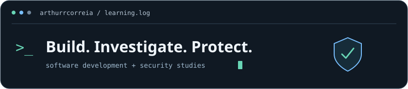
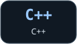
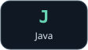

  

<h1 align="center">Arthur Correia de Barros Silva</h1>

  <strong>Cybersecurity Student | Offensive &amp; Defensive Security | Secure Software Development</strong>

Building software. Understanding threats. Learning to secure systems.

### Languages I study & practice

  
  
  
  
  

**Project stack** · TypeScript, Angular, Ionic, HTML/CSS  
**Lab foundations** · Linux, Bash, TCP/IP, HTTP  
**Exploring** · AI-assisted security analysis and automation

---

## About me

I'm a Systems Analysis and Development student focused on cybersecurity. I develop applications and study offensive and defensive security to understand how software can fail and how to protect it. Programming, Linux, and automation support my studies, and I'm interested in applying AI to security analysis and automation.

## Focus areas

My studies and technical interests span four connected areas:

- **Offensive security** — Studying penetration testing, vulnerability analysis, and application security through labs and authorized environments.
- **Defensive security** — Learning about network and endpoint security, Linux administration and hardening, threat monitoring, and analysis.
- **Secure software development** — Developing applications while learning about authentication, authorization, access control, testing, and input validation.
- **AI & security automation** — Exploring how automation and AI can support technical tasks, code analysis, and vulnerability understanding.

## Featured projects

### [MobileTicketsIonic](https://github.com/ArthurrCorreia/MobileTicketsIonic)

Academic mobile application for issuing service tickets, managing queues, and viewing service reports.

- **Built with:** TypeScript, Angular, Ionic, Capacitor.
- **Demonstrates:** Typed ticket models and a shared service connecting ticket issuance, counter calls, and reporting across tabs.

### [Cyberlabs](https://github.com/ArthurrCorreia/Cyberlabs)

Study journal documenting Linux endpoint investigation and network security exercises in controlled, simulated environments.

- **Lab tools:** Linux, Bash, Python's HTTP server, Nmap, tcpdump, systemd.
- **Demonstrates:** Documenting how processes, listening ports, and HTTP logs relate, with mitigation and retesting steps in a personal virtual machine.

### [web_ticket](https://github.com/ArthurrCorreia/web_ticket)

Browser-based service queue application with ticket issuance, a call display, and daily and monthly reports.

- **Built with:** HTML, CSS, JavaScript.
- **Demonstrates:** Queue handling, DOM updates, and report aggregation using in-memory application state.

---

## Connect

